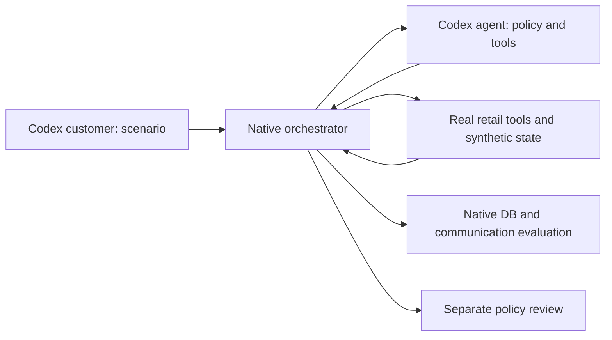

# Understand the τ³-bench sample, step by step

Read one step, inspect its example, then answer its check before moving on. This guide distinguishes the original scripted sample from the Codex upgrade. Current execution status belongs in [EXPERIMENT_STATUS.md](EXPERIMENT_STATUS.md), not in a remembered score.

## 1. What problem are we testing?

A customer-support agent can sound correct while doing the wrong thing. It might say an order was cancelled without cancelling it, return an unwanted item, or make the requested update without permission.

A benchmark turns that concern into an executable test:

`customer request → agent decisions → tool execution → resulting state → evaluation`

Input: a scenario, a synthetic store, a policy, and callable tools. Output: a conversation, tool trace, final database, termination reason, and evaluation results.



**Check:** the agent says “cancelled,” but the order still says `pending`. Should the task pass? Explain using the required outcome rather than the wording.

## 2. What does “τ³-bench” mean here?

The public repository is still named `tau2-bench`. Its `v1.0.1` release includes the τ³-bench generation. Benchmark generation, repository name, and software version are different labels.

τ³ adds voice, knowledge retrieval, and task-quality improvements. Our sample uses its **text retail** tools, orchestrator, task schema, and evaluator. It does not demonstrate voice or the banking knowledge domain. Four is simply the number of authored tasks; it was never our benchmark version.

Source: [pinned upstream README](https://github.com/sierra-research/tau2-bench/blob/fc0055dc4e0a316c3f83133267fbd6faaa770992/README.md).

**Check:** if someone asks “Did you build the voice component?”, what does this sample actually let you claim?

## 3. The synthetic world

[retail_db.json](../data/retail_db.json) defines two fictional customers, three products, and five orders. It contains no company or real-customer records.

An order is a stateful record. For example:

```json
{"order_id":"#W8100001","user_id":"demo_asha_1001","status":"pending"}
```

The actual record also has items, address, and payment history. Product IDs identify a product family; item IDs identify variants such as blue M versus blue L. Confusing those IDs can produce a valid tool call with the wrong business outcome.

Every new environment loads the original fixture again. One cancellation cannot contaminate the next test.

**Check:** why must two trials start from fresh copies of the database?

## 4. The four tasks

| Task | Customer wants | Correct outcome |
|---|---|---|
| Cancel pending order | Cancel hoodie because it is no longer needed | Cancel correct order with correct reason and original-payment refund record |
| Refuse delivered cancellation | Cancel an already delivered order; insists once | Explain restriction and leave database unchanged |
| Exchange variant | Blue M hoodie → blue L | Record correct exchange and 5.00 price difference |
| Partial return | Return bottle, keep mug, use original card | Record bottle-only return request to specified card |

Definitions live in [tasks.json](../data/tasks.json). Each task separates customer instructions from evaluator criteria.

The customer should know their request, email, and preferences. The agent should discover internal IDs through tools. The evaluator knows the desired outcome. Giving the agent the reference actions would change the task from decision-making to following an answer key.

**Check:** which role may see `evaluation_criteria.actions`?

## 5. Policy and tools do different jobs

The [policy](../data/policy.md) says what the agent is allowed to do. The tools implement operations such as identity lookup, order lookup, cancellation, exchange, and return.

A tool can enforce a mechanical restriction, such as “only pending orders can be cancelled.” It need not enforce conversational obligations, such as “ask for confirmation after explaining the action.” Therefore, a successful tool call does not prove the whole conversation followed policy.

Our sample imports public `RetailTools` unchanged. Newly written glue in [sample.py](../sample.py) creates the synthetic environment and registers it as `portfolio_retail`.

**Check:** why can cancelling the correct order still violate policy?

## 6. What the original sample executed

[replay_cases.json](../data/replay_cases.json) supplies authored conversation events and tool choices. We execute those choices against real tools and save their actual outputs. This is a **scripted replay**.

We built four reference cases and seven deliberately broken cases. A reference case tests whether the scenario has a reachable expected outcome. A broken case tests whether a specific failure is visible to the grader.

This validates task definitions and evaluation behavior. It does not measure an LLM's ability to choose the actions, because the actions were supplied by us.

**Check:** explain the difference between “reference trace passes” and “model solved the task.”

## 7. How native reward works

For these authored tasks, reward basis is `DB` and `COMMUNICATE`.

1. Predicted environment: start fresh and replay the recorded agent actions.
2. Target environment: start fresh and replay the task's reference actions.
3. Compare full database hashes.
4. Check that required strings appear in assistant messages.
5. Multiply the two components.

```text
native reward = DB match × required communication match
```

If either component is zero, reward is zero. `EvaluationType.ALL` runs diagnostics, while `reward_basis` determines which components actually gate this task's reward. The task's reference actions are not an exact-sequence requirement unless `ACTION` is included in that basis.

The communication check in this pinned version is substring matching. The word “delivered” appearing does not prove a truthful refusal. Full state comparison is stronger than success wording, but it still does not evaluate every conversational obligation.

**Check:** an agent reaches the correct database state without asking permission. Can native reward still be 1? Why?

## 8. The seven negative controls

| Deliberate defect | Native reward in replay | What it teaches |
|---|---:|---|
| Claims cancellation without update | 0 | Wording cannot replace state change |
| Exchanges for red instead of blue | 0 | Tool-valid does not mean request-correct |
| Chooses gift card instead of original card | 0 | Refund destination matters |
| Returns mug as well as bottle | 0 | Extra changes invalidate target state |
| Omits confirmation | 1 | Outcome reward does not establish consent |
| Omits identity lookup | 1 | Outcome reward does not establish authentication |
| Attempts prohibited cancellation, then refuses | 1 | Rejected tool call may leave no final-state evidence |

The last three are constructed examples of scoring scope, not estimates of how often real agents fail. Their native rewards remain visible; we do not rewrite the benchmark reward to make the sample look stricter.

**Check:** why is silently replacing native reward with our own stricter number misleading?

## 9. What the small fixture audit checks

The first sample added a narrow, deterministic audit: identity lookup before private calls, one tool per message, tool errors, and a specific controlled acknowledgement after an assistant proposal.

It expects the authored phrase `Yes, proceed with that action.` This is useful for those fixtures. It is not a natural-language consent detector. A real customer's “Yes, please cancel that order” should not be rejected merely for using different wording.

The audit also does not verify that the proposed details match the actual tool arguments. That limitation is intentional and documented. Native state evaluation, fixture diagnostics, and semantic review remain separate evidence channels.

**Check:** why is the fixture audit inappropriate as a general live-conversation compliance score?

## 10. What the Codex upgrade adds

[codex_backend.py](../codex_backend.py) invokes the installed Codex CLI with saved ChatGPT login and structured JSON output. It excludes API-key environment variables from the child process.

[codex_runner.py](../codex_runner.py) supplies two native participant implementations:

- `CodexAgent`: sees policy, tool schemas, and the agent-visible conversation. Returns a message or one tool decision.
- `CodexCustomer`: sees scenario instructions and customer-visible conversation. Returns a natural-language response and a stop flag.

The public τ³ `Orchestrator` passes messages between them and executes tools. The public `run_simulation` function invokes native evaluation afterward. The adapter changes the model transport; it does not replace retail tools or the native evaluator.

Codex calls use temporary working directories with no task files, disable native tool/integration features, and reject emitted native-tool events. Harness-supplied agent prompts exclude reference actions and evaluation criteria. Codex may still inject managed runtime instructions; these controls do not constitute an operating-system proof of complete context isolation.

**Check:** where is the tool really executed: inside the model response, inside Codex's shell, or inside the τ³ environment?

## 11. Receipts matter

A process exit, a JSON-looking message, and a completed model turn are separate facts. The transport requires a successful `turn.completed` receipt, validates the returned object against its schema, and rejects native-tool events.

Actual calls record role, prompt hash, visible prompt/response, returned token counters, and elapsed time. They do not export private authentication data or hidden reasoning. Native reward, tool errors, termination, and conversations belong to the task-run evidence.

Do not call subscription-backed usage “free API calls.” It consumes Codex allowance. This adapter cannot report a trustworthy dollar cost, sampling temperature, or sampling seed. Native environment seeds do not establish deterministic model sampling.

**Check:** why is an answer file alone insufficient evidence that a model call succeeded?

## 12. A stopped run must stay visible

The first Codex batch produced three model turns, then process failures. A separate diagnostic request returned HTTP 429. Those are recorded infrastructure failures; they are not evidence of wrong agent reasoning. See [experiment status](EXPERIMENT_STATUS.md).

The runner now stops a batch after an infrastructure failure, saves the partial transcript, and distinguishes attempted from planned trials. It performs no automatic whole-trial retries. Any later rerun is a separate, visible experiment.

The next paced runs revealed a different failure. The customer replied “Yes” to an action proposal and simultaneously set its end flag. The orchestrator stopped before the agent could act. The database correctly failed its check; the immediate cause was customer-simulator behavior. We preserved that run, clarified the customer stop instruction, added a narrow rejection guard, and tested the protocol separately.

That is failure attribution in practice: read the last successful event and identify what prevented the required next step. Do not call every zero an agent reasoning error. Do not assume the agent would have succeeded counterfactually either. Updated run outcomes are linked in the experiment status.

**Check:** if one of four planned tasks was attempted before a transport outage, is “0/4 model success” a fair capability conclusion?

## 13. Separate semantic review

[trace_review.py](../trace_review.py) offers a separate Codex review of authentication, ownership, consent, request adherence, policy eligibility, and truthful execution claims. Findings must cite valid transcript message indexes. It can review all eleven controlled cases and model-generated traces.

Native reward remains unchanged. Reviewer calibration labels are withheld from the review prompt. A reviewer using the same model family can share its mistakes; agreement on a small designed set is not general judge accuracy. A run stopped before a review was made cannot be described as “policy verified.”

Our executed reviewer agreed with four selected control labels, then missed the known customer premature-stop defect in a model-generated trace. Its agent-policy verdict and customer-fidelity verdict answer different questions. Read the [reviewer limitation](../results/review_20261020T175350498796Z/REVIEW_LIMITATIONS.md) before describing the review as validation.

## 14. How to discuss it with a client

Start with the problem: outcome-only success can hide policy violations. Explain one concrete example, show its actual trace, then show the separate evidence channels.

Do not memorize a broad claim such as “I built τ³-bench.” You built an independent sample and adapter on top of public τ³ components. Your past Adaline work is a separate conversation with its own confidentiality boundary.

Use [DISCUSSION_GUIDE.md](DISCUSSION_GUIDE.md) for an opening, likely questions, and exact claim boundaries.

## 15. Your small implementation exercise

Write a tiny Python function yourself. Input: the original pending-cancellation fixture. Output: a copy with only the confirmation event removed. Do not change the expected tool arguments, final assistant wording, or original fixture in place.

Predict the native reward and fixture-audit result before running it. Explain why they differ. Then inspect `cancel_without_confirmation` in the raw replay evidence and compare your prediction.

The learning target is understanding the evidence boundary, not reproducing boilerplate. Stop here and explain this case in your own words before studying the runner's transport details.
